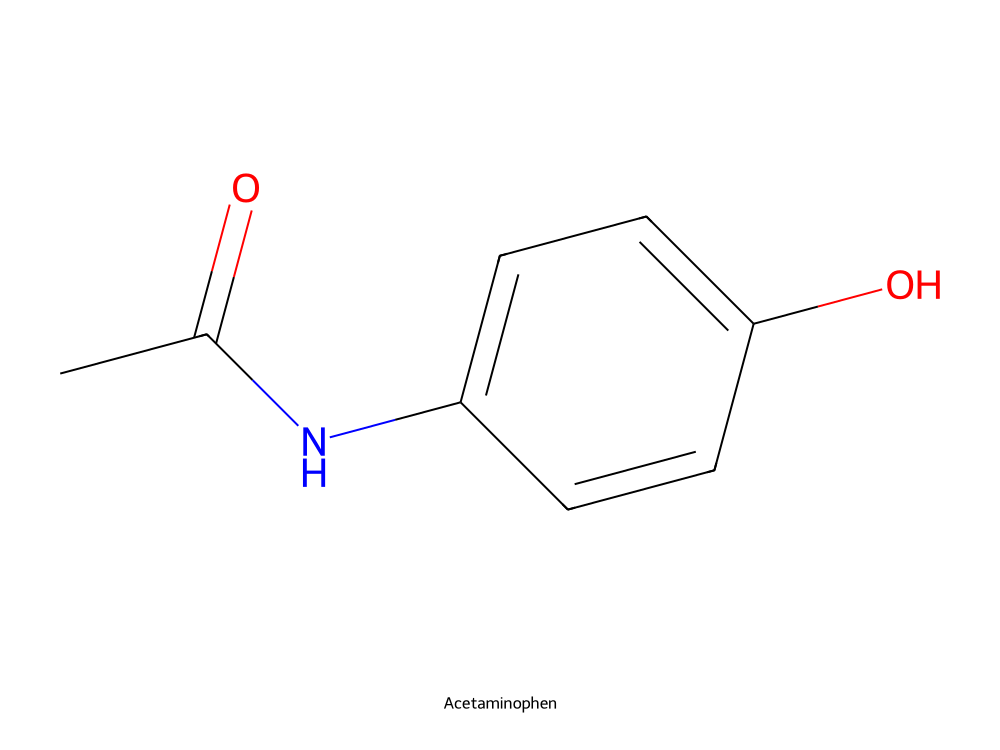
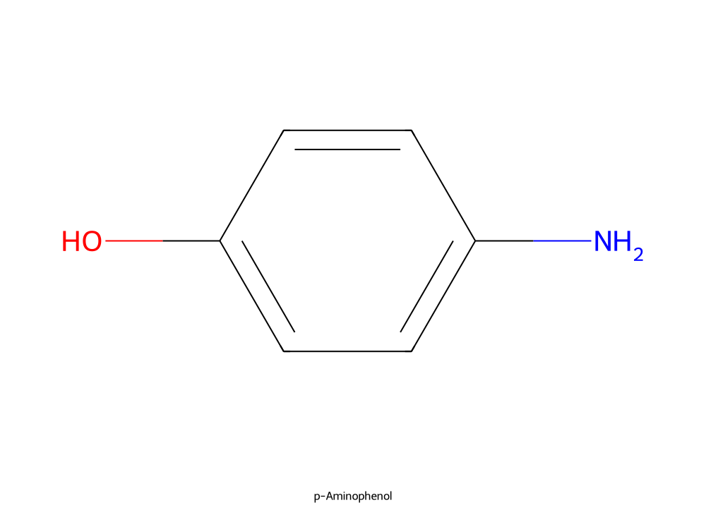
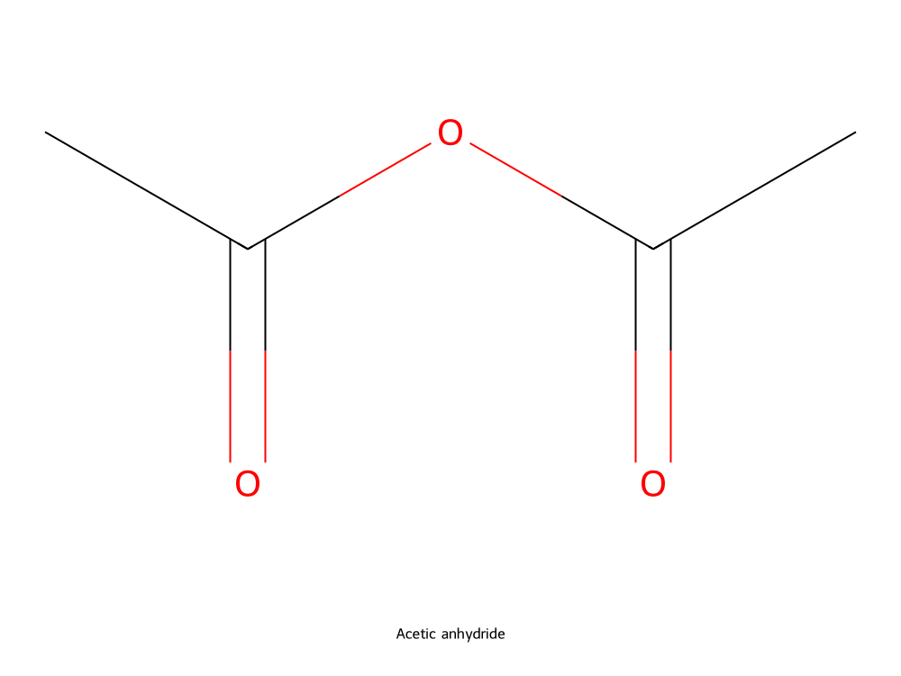
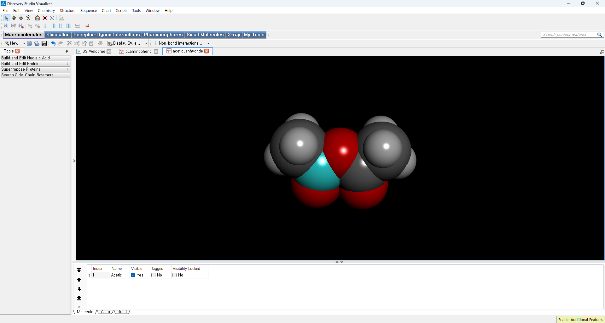
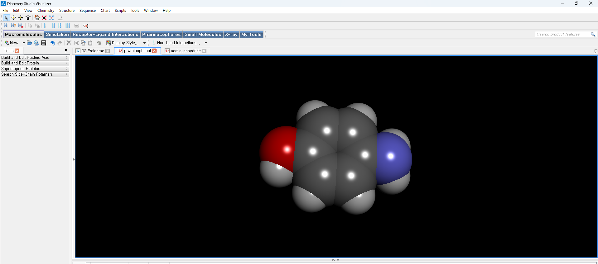
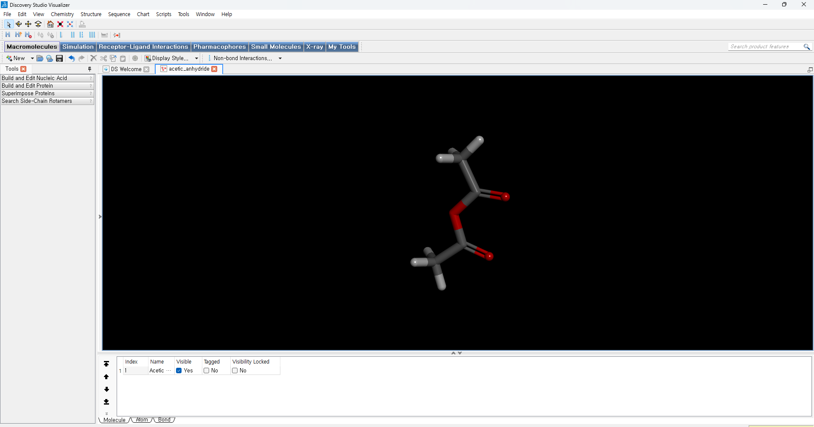
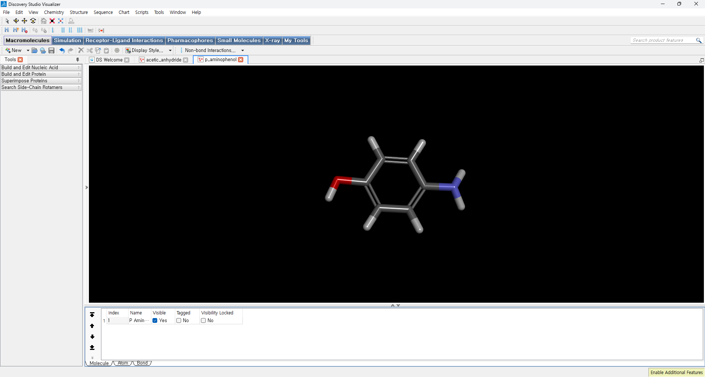

# 아세트아미노펜 최종 보고서

**대상 분자:** 아세트아미노펜(Acetaminophen)  
**SMILES:** `CC(=O)Nc1ccc(O)cc1`  
**선정 CAS:** 103-90-2  
**실행 기록 위치:** `runs/acetaminophen/`  

---

## 요약

AiZynthFinder 4.4.1은 아세트산 무수물과 p-아미노페놀의 1단계 경로를 최상위 해결책으로 도출했고, SynthEx(Solar Pro 4)는 전략 2건을 생성한 뒤 경로 구축(`routes`) 단계에서 `ValueError`로 실패해 경로를 제공하지 못했다. ASKCOS v2 FP의 1순위는 무용매 43.65 °C(316.80 K)이며 2순위는 물이 포함돼 아세트산 무수물 가수분해 충돌이 확인됐고, Parrot은 온도를 예측하지 않고 용매 중심 15개 후보를 제시했다. Yield-BERT와 DRFP는 Buchwald–Hartwig 학습 범위 밖으로 적용 불가(`null`) 판정했으며, 가산점 분석으로 EPI Suite 물성·상태 비교, MOPAC O–H pKa, RDKit 2D 이미지, Discovery Studio 3D CPK 관찰을 함께 수행했다.

## 1. 물질 선정 이유

아세트아미노펜은 대표적인 해열·진통제 성분이며, p-아미노페놀과 아세트산 무수물의 단순 1단계 아실화(아세틸화)로 합성할 수 있어 유기합성 수업 프로젝트의 예시로 적합하다. 역합성 오픈소스 도구(AiZynthFinder)와 LLM 기반 경로 도구(SynthEx), 조건 추천 모델(ASKCOS v2 FP, Parrot), 수율 모델(Yield-BERT, DRFP), 그리고 물성·양자화학 가산점 분석(EPI Suite, MOPAC, 2D 구조 이미지)을 한 분자에서 함께 적용하고 기록해 보는 것이 본 프로젝트의 목적이다. SMILES는 제공받은 자료를 RDKit 기준으로 확인한 `CC(=O)Nc1ccc(O)cc1`을 사용했고, 원본 한 줄 파일 `target.smi`에 저장했다.

---

## 2. 역합성: AiZynthFinder

**실행 버전 및 명령:** AiZynthFinder 4.4.1  
`aizynthcli --config config-course.yml --smiles target.smi --policy uspto --filter uspto --stocks zinc --output routes.json`

**결과 요약:** `is_solved=true`, 46개 탐색 경로 중 23개 해결, 1단계 경로가 최상위였다. 출발 물질은 아세트산 무수물(`CC(=O)OC(C)=O`)과 p-아미노페놀(`Nc1ccc(O)cc1`)이며, 두 물질 모두 ZINC 스톡 정보로 표시됐다(`precursors_availability: zinc;zinc`).  

**해석상 주의:** 이 결과는 역합성 해(solution)이며, 스톡 표시는 실제 실험 가능이나 반응 성공을 뜻하지 않는다. 선택 경로는 `aizynthfinder/routes.json`, `stats.json`, `manifest.json`, `run.log`(종료코드 0)에 근거한다.

**선택 경로의 정방향 반응:** AiZynthFinder 상위 노드의 역합성 절단식을 정방향으로 뒤집어 아래 1단계 정반응을 구성했다. 원본 노드는 타깃 생성물만 제시하므로 모델 입력은 주생성물 기준 반응 SMILES를 그대로 유지했다.

- 정방향 반응 SMILES(모델 입력): `CC(=O)OC(C)=O.Nc1ccc(O)cc1>>CC(=O)Nc1ccc(O)cc1`
- 화학량론 포함(부산물 아세트산 기록): `CC(=O)OC(C)=O.Nc1ccc(O)cc1>>CC(=O)Nc1ccc(O)cc1.CC(=O)O`
- 반응 분류: 아민 아실화(아세트산 무수물에 의한 아세틸화)

상세 변환 근거와 방향 역전 표시는 `results/route_reactions.json`에 있다.

### 2D 구조 이미지

- **아세트아미노펜 2D 구조**

- **p-아미노페놀 2D 구조(반응물)**

- **아세트산 무수물 2D 구조(반응물)**

- **정방향 반응식 도식(부산물 아세트산 포함)**

---

## 3. 역합성: SynthEx (submission branch)

**실행 환경:** `synthex/run2` 디렉터리, Solar Pro 4 프로필(OpenAI 호환 제공자), `strategy_count=2`, `route_step_limit=12`, `route_proposal_attempts=2`.

**결과:** 전략 생성 단계는 완료됐으나 경로 구축 단계는 실패했고, 전체 상태는 `failed`이다. 실패는 `routes` 단계에서 발생했으며, `manifest.json`의 `failure` 항목은 다음과 같이 기록한다.

- `stage: routes`
- `category: ValueError`
- 첫 번째 실패 메시지: `every item in stage 'routes' failed; first failure was ValueError: Route Builder exhausted 2 proposals for step 2: ValueError: step S2: execute_ops failed: Op [0] break_bond: ValueError: no bond exists between atoms 1 and 7 op_dict: {'op': 'break_bond', 'map_a': 2, 'map_b': 8}`

**로그:** `synthex/execution2.log`에 `Can't kekulize mol. Unkekulized atoms: 4 5 6 9 10` 및 위 ValueError와 `EXIT_CODE=2`가 저장돼 있다.

**LLM 전략 출력:** 생성된 전략은 `run2/strategies.json`에 보존돼 있으며, 아래에 그대로 옮긴다.

1. Form the para-substituted scaffold via a Suzuki-Miyaura cross-coupling between a protected 4-aminophenol boronic ester and an acetyl-protected acetamide electrophile.
2. Construct the scaffold using a Buchwald-Hartwig amination between a protected 4-halophenol and an acetamide nucleophile.

**해석:** 두 전략은 본 반응과 무관한 교차 커플링 계열이며, 이후 내부 검증(break_bond 원자 번호 불일치 등)에서 경로 구축이 중단됐다. 따라서 SynthEx로는 합성 경로를 도출하지 못했고, 아래 이후 분석은 AiZynthFinder로 선택한 1단계 정반응을 기준으로 진행한다. 실패 단계와 오류 메시지는 위 파일명과 로그 원문을 근거로 하며, 임의의 경로를 만들지 않는다.

---

## 4. 조건 모델: ASKCOS v2 FP

**실행 방식:** ASKCOS context_recommender 저장소의 v2 FP 서비스를 로컬 Docker로 실행한 뒤 `POST /api/v2/condition/FP`로 추론했다. 완전 원본 응답은 `results/askcos_raw.json`에 저장했고, 환경·빌드·health 체크 정보는 `results/environment_status.json`에 있다.

**입력:**

- 반응 SMILES: `CC(=O)OC(C)=O.Nc1ccc(O)cc1>>CC(=O)Nc1ccc(O)cc1`
- reagents: `[]`
- n_conditions: `3`

**온도 변환:** `°C = K − 273.15`. 원본 Kelvin 값과 score는 `askcos_raw.json` 및 요약표에 함께 기재했다. score는 수율/확률이 아니다.

**원본 서비스 응답에서 정리한 상위 3개:**

| 순위 | 성분(역할/양 그대로) | 온도(K) | 온도(°C) | score | 화학 검토 |
|---:|---|---|---:|---:|---|
| 1 | 아세트산 무수물(REACTANT, 1.3159), p-아미노페놀(REACTANT, 1.0000) | 316.8039 | 43.65 | 0.1131 | 추가 용매·촉매·시약이 없으므로 아민 아세틸화로 설명 가능한 조합이다. 무수물 과량·조건에 따라 페놀성 OH의 O-아세틸화가 경쟁할 수 있어 선택성은 실험 확인이 필요하다. |
| 2 | 아세트산 무수물(REACTANT, 1.3062), p-아미노페놀(REACTANT, 1.0000), 물(역할 미지정, 119.5522) | 316.5035 | 43.35 | 0.0280 | **강한 충돌:** 물이 아세트산 무수물을 가수분해해 아세틸화제를 소모할 수 있다. 모델이 큰 양으로 제시한 조합이므로 그대로 재현할 조건으로 보기 어렵다. |
| 3 | 아세트산 무수물(REACTANT, 1.1415), p-아미노페놀(REACTANT, 1.0000), 디클로로메탄(역할 미지정, 25.5039), 트리에틸아민(역할 미지정, 1.7188) | 281.8193 | 8.67 | 0.0244 | 뚜렷한 직접 반응 모순은 보이지 않는다. 디클로로메탄은 용매, 트리에틸아민은 산 포집 염기로 해석 가능한 조합이다. 온도는 디클로로메탄 끓는점보다 낮다. |

**출력 해석 주의:** 모델이 제공하지 않은 성분 역할은 임의 단정하지 않고 “역할 미지정”으로 표기했다. 성분 양은 원응답 값을 반올림해 보고했으며, score는 수율이나 성공 확률이 아니다.

**빌드·실행 특이사항:** 저장소 기본 Dockerfile은 Apple Silicon(`linux/aarch64`)에서 `tensorflow-cpu==2.7.4`의 ARM64 wheel 부재로 빌드 중단됐다. 이번 실행에서는 임시 Dockerfile로 `tensorflow-aarch64==2.7.4`와 conda-forge `h5py=3.11`을 써서 이미지를 빌드했고, 기본 저장소의 Dockerfile은 변경하지 않았다. `/health`는 `{"message":"Alive!"}`를 반환했으며, 예측 후 컨테이너를 종료했다. 빌드 중 SciPy 1.7.3과 NumPy 1.24.4 범위 경고가 있었지만 모델 로딩과 API 예측은 완료됐다. 상세는 `environment_status.json`에 있다.

---

## 5. 조건 모델: Parrot

**실행 환경:** conda `parrot-cpu` 환경(osx-arm64), Python 3.9.23, PyTorch 1.13.1(CPU 추론), RDKit 2025.03.5, Transformers 4.18.0, tokenizers 0.12.1, SimpleTransformers 0.63.6, rxnfp 0.1.0.  
체크포인트: `outputs/Parrot_train_in_USPTO_Condition_enhance`. 설정: `configs/config_inference_use_uspto.yaml`.

**입력 파일:** `results/parrot_input.txt`(반응 SMILES 한 줄)  
**명령:** `python inference.py --config_path configs/config_inference_use_uspto.yaml --input_path results/parrot_input.txt --output_path results/parrot_raw.csv --num_workers 1 --inference_batch_size 8 --gpu -1`  
**결과:** CPU 추론 성공, 종료코드 0. 전체 15개 후보 CSV는 `results/parrot_raw.csv`에 있다.

Parrot USPTO 설정은 `use_temperature: false`여서 온도를 예측하지 않는다. 아래는 원CSV에서 상위 3개를 요약한 표다.

| 순위 | solvent1 | score | 화학 검토 |
|---:|---|---:|---|
| 1 | 물(`O`) | -0.8904 | 아세트산 무수물이 물과 가수분해될 수 있어 경쟁 소모 가능성 주의. 수용액 아세틸화 자체가 불가능하다는 뜻은 아니다. |
| 2 | 에탄올(`CCO`) | -2.5844 | 에탄올이 아세트산 무수물에 의해 에틸 아세테이트로 전환될 수 있어 경쟁 소비 우려. |
| 3 | DMF(`CN(C)C=O`) | -2.8837 | 뚜렷한 직접 상호 반응 모순은 보이지 않는다. 용매만 추천됐으며 촉매·시약 칸은 비어 있어 별도 조건 완성이 필요하다. |

**출력 해석 주의:** Parrot의 점수는 beam-search 순위 점수로 확률이나 수율이 아니다. 원본 CSV에는 15개 후보가 모두 들어 있으며, 요약표는 상위 3개만 옮겼다. 환경 실행 중 `pip check`에는 rxnfp의 레거시 고정 메타데이터 불일치가 남지만, 실제 import와 예측은 수행돼 CSV가 생성됐다. 상세는 `results/parrot_execution.log` 및 `REPORT.md` 참고.

---

## 6. 수율 모델 적용성 판정

이번 반응은 아릴 할라이드와 아민의 Pd 촉매 Buchwald–Hartwig C–N 커플링이 아니라, 아세트산 무수물을 이용한 아민 아세틸화다. 13주차 절차에 따라 두 수율 모델 모두 학습 반응군 밖으로 판정했고, 수율 예측을 실행하지 않았다. 결과 JSON에는 `applicable_as_yield_prediction: false`와 `raw_model_output_percent: null`을 그대로 기록했다.

- **Yield-BERT:** Buchwald–Hartwig FullCV_01 체크포인트 파일은 있지만 적용 불가.
- **DRFP:** `models/buchwald-hartwig-xgb-model.json` 및 관련 전처리 자료가 있지만, 해당 체크포인트는 Buchwald–Hartwig 전용이므로 적용 불가. DRFP 자체는 지문 생성기이며, 수율 예측은 별도 회귀분석 모델이 필요하다.

가짜 수율을 만들어 표에 넣지 않았다. 판단 근거와 파일 위치는 `results/yieldbert_route_results.json`, `results/drfp_route_results.json`, `results/environment_status.json`에 있다.

---

## 7. 종합 결론

AiZynthFinder는 아세트아미노펜을 1단계 역합성으로 해결했고, 그 상위 경로를 정방향 반응 SMILES로 바꾸어 조건 모델 입력으로 사용했다. ASKCOS v2 FP와 Parrot는 모두 조건 후보를 제시했지만, 둘은 같은 반응 SMILES를 입력했음에도 제안 성격이 달랐다. ASKCOS 1순위는 두 반응물만으로 구성돼 아민 아세틸화 맥락에서 가장 단순하며, 온도는 316.80 K(43.65 °C)다. 다만 모델 score는 수율이나 성공 확률이 아니고, 조건 성분 중 물은 아세트산 무수물과 가수분해 충돌을 일으킬 수 있어 그대로 재현 조건으로 보기 어렵다. Parrot 상위 후보는 용매 중심이며 온도 예측은 없다.

수율 추정 측면에서는 본 반응이 Buchwald–Hartwig 커플링이 아니므로 Yield-BERT와 DRFP 모두 적용 불가로 판정했고, 임의의 수율 값을 부여하지 않았다. 실험 수율이나 반응 선택성(페놀성 O-아세틸화 경쟁에서 N-아세틸화 선택성 확보 여부 등)은 본 모델 결과만으로 확정할 수 없으며, 실제 실험 확인이 필요하다. SynthEx는 전략 제안은 출력했지만 경로 구축에서 오류(break_bond 원자 번호 불일치, kekulization 경고 등)로 중단돼 경로를 제공하지 못했다. 이 실패는 `synthex/run2/manifest.json`과 `synthex/execution2.log`에 기록된 내용을 근거로 한다.

---

## 8. AI 모델의 성능 및 한계

### 8.1 AiZynthFinder

- 강점: 대상 분자를 한 단계 역합성으로 빠르게 해결했고, 출발 물질의 스톡 여부까지 제시했다. 다만 결과는 역합성 가능성이며 실험 가능성·실현성과는 구분해야 한다.
- 한계: 스톡 정보는 purchasable 표시와 같은 실험실 가용성 증거가 아니다. 본 프로젝트에서는 1개 최상위 경로를 임의로 선정해 조건/수율 입력으로 썼으며, 다른 22개 해결 경로가 더 적합할 가능성은 검토하지 않았다.

### 8.2 SynthEx

- 강점: LLM 전략 제안을 출력했다.
- 한계: 경로 구축 단계에서 다음 오류가 발생해 최종 경로가 생성되지 않았다.
  - `Route Builder exhausted 2 proposals for step 2`
  - `break_bond` op에서 `no bond exists between atoms 1 and 7`, `op_dict: {'op': 'break_bond', 'map_a': 2, 'map_b': 8}`
  - kekulization 경고(`Can't kekulize mol. Unkekulized atoms: 4 5 6 9 10`)
  - 첫 오프라인 시도에서 DNS 실패 기록(오프라인 환경의 네트워크 문제)
- 위 내용은 `synthex/run2/manifest.json`(failure 항목)과 `synthex/execution2.log`(종료코드 2)에 근거한다. 생성된 전략은 2건이지만 모두 교차 커플링 계열이고 실제 경로로는 이어지지 않았다. LLM 제안과 내부 Critic/Editor 합의는 실험실 검증이 아니다.

### 8.3 ASKCOS v2 FP

- 강점: 전방향 반응 SMILES 입력으로 조건 후보를 반환했으며, 성분·온도·score가 구조화된 원응답으로 남았다.
- 한계:
  - score는 수율이나 성공 확률이 아니다.
  - 성분 역할이 항상 명시되지 않아(예: 물, 디클로로메탄, 트리에틸아민 등 “미지정”) 해석을 임의로 단정하지 않았다.
  - 제안된 물이 아세트산 무수물과 가수분해 충돌을 일으킬 수 있어 그대로 재현 조건으로 보기 어렵다.
  - 원본 Dockerfile은 Apple Silicon에서 tensorflow-cpu wheel 부재로 실패했고, 이번 실행은 임시 대체 빌드를 사용했다(지원되는 기본 빌드가 아니다).
  - SciPy/NumPy 버전 경고가 있었지만 예측은 완료했다.

### 8.4 Parrot

- 강점: CPU에서 15개 조건 후보를 생성했다.
- 한계:
  - USPTO 설정에서 온도를 예측하지 않는다.
  - 점수는 beam-search 순위 점수일 뿐 수율/확률이 아니다.
  - 환경 점검(`pip check`)상 rxnfp의 레거시 고정 메타데이터(scipy, scikit-learn, matplotlib) 불일치 경고가 남아 있으며, 당시 버전들은 Apple Silicon 바이너리 버전과 완전히 정합하지 않는다. 다만 실제 import와 추론은 수행돼 결과 CSV가 생성됐다.
  - 상위 후보 중 물과 에탄올은 아세트산 무수물과 경쟁 반응 가능성 때문에 해석에 주의가 필요하다.

### 8.5 수율 모델 (Yield-BERT, DRFP)

- 두 모델 모두 이 반응에서 실행하지 않았다.
- 이유: 아세트아미노펜 형성 반응은 대상이 되는 결합 유형(aryl halide + amine의 Pd 촉매 Buchwald–Hartwig C–N 커플링)이 아니며, 번들 체크포인트의 학습 반응군 밖에 있다.
- 이 판정은 13주차 절차에 따라 내렸으며, null/원본 출력 없음으로 기록했다. 임의의 수율 값을 만들지 않았다.

### 8.6 종합적 한계

- 모든 결과는 실험 수율이 아니라 모델 출력 또는 모델 적용성 판단이다.
- 조건 모델 간 성분이 서로 다를 수 있으며, 일부 성분(물 등)은 반응물과 충돌할 수 있다.
- 수율 예측 모델 적용성은 반응군 기준으로만 판단했고, 세밀한 기질·촉매·용매 효과까지 반영한 수율 추정은 본 데이터로 제공되지 않는다.

---

## 9. 가산점 분석

### 9.1 EPI Suite 물성 조회

- 조회일: 2026-11-24
- 실제 조회 서버: `https://episuite.dev/api`
- 요청 방식: CAS 검색 `/api/search?query={CAS}&limit=10` 및 물성 조회 `/api/submit?cas={CAS}&modules=physicalProperties`
- 세 물질 모두 검색·물성 요청이 HTTP 200으로 성공했고, 원본 응답은 `bonus/episuite_raw/`에 그대로 저장했다. 원본 서버 런타임 상태는 `degraded`였으나 이번 조회 6건은 성공했다.
- **값 선택 원칙:** `valueType=EXPERIMENTAL`이 있을 때만 우선 선택하고, 없으면 `ESTIMATED`를 사용했다. 이번 응답에는 `valueType=EXPERIMENTAL`로 지정된 물성이 없었고, `experimentalValues` 배열에는 `valueType=EVIDENCE`/`evidenceType=UNSPECIFIED` 항목이 있었다. 출처 설명에는 “calculated”, “slope analogy” 등이 포함돼 있어 이를 실험 측정값으로 바꾸어 부르지 않고 별도 항목으로 남겼다. 상태 판정표의 비교 기준은 EPI 응답의 `estimatedValue`다.
- 아래 표에서 ASKCOS 비교 온도는 1순위 예측값인 43.65 °C를 사용했다.

| 물질 | CAS | 융점(°C, 선택값: ESTIMATED) | 끓는점(°C, 선택값: ESTIMATED) | EPI EVIDENCE 융점/끓는점(°C) | ASKCOS 온도(°C) | 온도에서 상태(ESTIMATED 기준) |
|---|---|---:|---:|---|---:|---|
| p-아미노페놀 | 123-30-8 | 53.57 | 241.84 | 187.5 / 284.0 | 43.65 | 고체(43.65 < 융점) |
| 아세트산 무수물 | 108-24-7 | -95.10 | 52.62 | -73.0 / 139.5 | 43.65 | 액체(융점 < 43.65 < 끓는점) |
| 아세트아미노펜 | 103-90-2 | 119.92 | 340.65 | 170.0 / 자료 없음 | 43.65 | 고체(43.65 < 융점) |

- **EVIDENCE 값 설명(원문 분류 유지):**
  - p-아미노페놀 융점 187.5 °C: “Physprop calculated - based upon VP / Water Sol data”
  - 아세트산 무수물 융점 -73.0 °C: “Ester slope analogy”
  - 아세트아미노펜 융점 170.0 °C: “-N-C(=O) type slope analogy”
  - 다른 EVIDENCE 끓는점: 284.0 °C, 139.5 °C (evidenceType UNSPECIFIED)

**온도·상태 비교 결론:** ASKCOS 1순위 예측 온도 43.65 °C에서 p-아미노페놀과 아세트아미노펜은 ESTIMATED 융점보다 낮아 고체, 아세트산 무수물은 액체 범위로 추정된다. 다만 이 값은 EPI Suite 추정값이며, ASKCOS 온도는 모델 예측이므로 실험 온도를 확정하는 근거가 아니다. 43.65 °C에서 p-아미노페놀이 고체이므로, ASKCOS 1순위처럼 용매 후보가 따로 없는 조건에서는 반응물 용해·혼합을 위한 용매 검토가 필요하다. 원본 응답 JSON과 HTTP 상태 파일은 `bonus/episuite_raw/`에 있다.

### 9.2 MOPAC 양자 계산

13주차 4.3 절차를 적용했다: 3D 중성 구조에 대해 먼저 `CHARGES`를 돌리고 이상 전하가 없음을 확인한 뒤, `PM6 pKa CHARGE=0`으로 O–H 수소의 pKa를 계산했다. 3D 좌표는 RDKit ETKDG/MMFF94로 준비했고, 아세트아미노펜은 제공된 conformer를 MMFF94로 정리했다. pKa는 실험값이 아니라 계산 추정값이다. 두 물질 모두 CHARGES에서 “NO CHARGES FOUND.”가 확인됐고, pKa 계산은 `JOB ENDED NORMALLY`로 종료됐다(exit code 0).

| 물질 | CHARGES 결과 | pKa 입력 | pKa 출력 | pKa(O–H H 원자 번호) | 종료 상태 |
|---|---|---|---|---:|---|
| p-아미노페놀 | NO CHARGES FOUND. | mopac/p_aminophenol_pka.mop | mopac/p_aminophenol_pka.out | 9.786 (H atom 13) | 두 실행 모두 exit code 0; pKa 작업 JOB ENDED NORMALLY |
| 아세트아미노펜 | NO CHARGES FOUND. | mopac/acetaminophen_pka.mop | mopac/acetaminophen_pka.out | 9.495 (H atom 12) | 두 실행 모두 exit code 0; pKa 작업 JOB ENDED NORMALLY |

- CHARGES 원본 입출력은 `mopac/p_aminophenol_charges.mop/.out`, `mopac/acetaminophen_charges.mop/.out`에 있다. CHARGES가 “JOB STOPPED HERE BECAUSE KEYWORD `CHARGES` WAS USED”로 끝나는 것은 전하만 출력하고 계산을 멈추는 해당 키워드의 정상 동작이다.
- 아세트아미노펜 O–H pKa(9.495)는 p-아미노페놀(9.786)보다 계산상 약 0.29 낮다. 두 값의 차이는 모델 기반 비교이며, 이 계산만으로 실험 조건에서의 반응성이나 선택성을 확정하지 않는다.
- MOPAC 출력에는 Intel MKL SSE4.2 사용 중단 예정 경고가 있었지만, 계산은 모두 정상 종료했다.

### 9.3 2D 구조 및 반응식 이미지

- 아세트아미노펜, p-아미노페놀, 아세트산 무수물의 RDKit 2D 이미지를 보고서에서 사용했다(각각 `bonus/acetaminophen_2d.png`, `bonus/p_aminophenol_2d.png`, `bonus/acetic_anhydride_2d.png`).
- 부산물 아세트산까지 포함한 정방향 반응식 2D 도식을 본문에 삽입했다(`bonus/forward_reaction_scheme.png`).
- 이미지 용량이 커지지 않도록 너비만 제한하고 삽입했으며, 원본 파일은 수정하지 않았다.

### 9.4 3D 접근성 및 CPK 접근성 관찰

3D SDF 파일(`bonus/3d_structures/p_aminophenol.sdf`, `bonus/3d_structures/acetic_anhydride.sdf`, `bonus/3d_structures/acetaminophen.sdf`)은 구조 입력으로서 존재한다. 이번 프로젝트에서는 학교 Windows PC의 Discovery Studio Visualizer에서 아세트산 무수물과 p-아미노페놀의 CPK 공간 채움 모형을 캡처했고, 그 결과 이미지를 `bonus/`에 저장했다. 실제 존재하는 캡처 파일만 아래에 삽입한다.

- **아세트산 무수물 — CPK 모형(반응 중심 카보닐 탄소 청록색 표시)**

- **p-아미노페놀 — CPK 모형(아민기·페놀기 노출)**

- **참고: 아세트산 무수물 막대 모형**

- **참고: p-아미노페놀 막대 모형**

관찰 내용(실제 캡처 이미지에서 확인된 시각적 노출만 기술):

- 아세트산 무수물은 반응 중심 카보닐 탄소(청록색 표시)가 주변 메틸기와 산소 사이로 표면이 드러나 있어, 다른 분자나 친핵체가 접근할 수 있는 방향이 보인다.
- p-아미노페놀은 아민 질소(-NH2, 파란색)와 페놀 산소(-OH, 빨간색)가 벤젠 고리 양쪽 바깥으로 노출되어 있고, 뚜렷한 입체 가려짐은 보이지 않는다.
- 이번 관찰은 Discovery Studio Visualizer의 CPK 공간 채움 모형 캡처 이미지를 기준으로 한 시각적 확인이며, 별도 원자 거리(Å) 측정이나 주변 원자 개수 세기는 수행하지 않았다. 따라서 임의의 거리·개수·서식을 넣어 기술하지 않는다. CPK 접근성 판단은 실제 캡처 이미지에서 확인된 표면 노출 여부만 기준으로 하며, 이 관찰만으로 반응성이나 선택성을 확정하지는 않는다.

---

## 10. 재현성 정보

**대상 분자:** 아세트아미노펜, SMILES `CC(=O)Nc1ccc(O)cc1`, CAS 103-90-2  
**원본 한 줄 파일:** `runs/acetaminophen/target.smi`

**역합성(AiZynthFinder):** 버전 4.4.1, 명령 참조는 `aizynthfinder/manifest.json`과 `run.log`, 결과 원문은 `routes.json`, `stats.json`, `config-course.yml`, `asset-manifest.json`에 있다. 자산 체크섬은 `manifest.json`의 assets 항목에 기록돼 있다.

**SynthEx:** `synthex/run2/manifest.json`(실패 상태, failure 항목, config, 코드 리비전, 의존성 버전), `synthex/run2/strategies.json`, `synthex/execution2.log`(종료코드 2). 제공자는 OpenAI 호환 프로필, 모델은 Solar Pro 4. API 키는 환경 변수에만 보관했고 보고서에는 포함하지 않았다.

**ASKCOS v2 FP:** 원본 응답은 `results/askcos_raw.json`, 환경·빌드·health 체크는 `results/environment_status.json`. 서비스 스타트업 접근과 엔드포인트는 저장소 README 및 `ASKCOS_SETUP.md`를 따랐다. 기본 Dockerfile 빌드 실패와 대체 빌드 검증은 환경 파일에 기록했다.

**Parrot:** 환경·버전·명령은 `results/environment_status.json`의 `parrot` 항목, 실행 로그는 `results/parrot_execution.log`, 원본 CSV는 `results/parrot_raw.csv`, 입력은 `results/parrot_input.txt`, 설정은 `configs/config_inference_use_uspto.yaml` 기준의 체크포인트 구성을 사용했다.

**수율 모델:** Yield-BERT, DRFP 모두 적용 불가로 판정했고 수율을 생성하지 않았다. 판정 근거는 `results/yieldbert_route_results.json`, `results/drfp_route_results.json`, `results/environment_status.json`에 있다.

**가산점 원본 파일:**

- EPI Suite: `bonus/episuite_results.md`, `bonus/episuite_raw/*.json`, `*.http_status.txt`
- MOPAC: `bonus/mopac_summary.md`, `bonus/mopac/*.mop`, `bonus/mopac/*.out`
- 2D 이미지: `bonus/acetaminophen_2d.png`, `bonus/p_aminophenol_2d.png`, `bonus/acetic_anhydride_2d.png`, `bonus/forward_reaction_scheme.png`
- 3D SDF: `bonus/3d_structures/*.sdf`
- CPK·막대 모형 캡처: `bonus/acetic_anhydride_cpk.png`, `bonus/p_aminophenol_cpk.png`, `bonus/acetic_anhydride_stick.png`, `bonus/p_aminophenol_stick.png`
- CPK 캡처 도구: 학교 Windows PC Discovery Studio Visualizer(CPK 공간 채움 모형), 입력 SDF: `bonus/3d_structures/acetic_anhydride.sdf`, `bonus/3d_structures/p_aminophenol.sdf`

**원응답 보존 원칙:** 모든 모델 원시 출력(JSON/CSV/log)은 변경하지 않고 그대로 보관했으며, 본문의 표와 서술은 그 요약·해석이다. 모델 score는 수율·확률이 아니며, 수율 모델 값은 생성하지 않았다.

**문서 버전 및 렌더링:** 이 보고서는 원본 텍스트 마크다운에서 렌더링했고, 최종 결과물은 `report/`에 저장했다.

### 사용한 모델과 저장소

| 역할 | 모델 | 저장소 | 버전·설정 | 실행 |
|---|---|---|---|---|
| 합성 경로 | AiZynthFinder | https://github.com/MolecularAI/aizynthfinder | 4.4.1, USPTO 정책·필터, ZINC 스톡 | 실행(해결) |
| 합성 경로 | SynthEx | https://github.com/schwallergroup/synthex/tree/submission | submission 브랜치, Solar Pro 4 | 실행(경로 단계 실패) |
| 합성 조건 | ASKCOS context_recommender | https://gitlab.com/mlpds_mit/askcosv2/context_recommender | v2 FP, Docker(ARM64 임시 빌드), 후보 3개 | 실행 |
| 합성 조건 | Parrot | https://github.com/wangxr0526/Parrot | USPTO 체크포인트, CPU 추론, 온도 미예측 | 실행 |
| 산출율(수율) | Yield-BERT (rxn_yields) | https://github.com/rxn4chemistry/rxn_yields | Buchwald–Hartwig FullCV_01 체크포인트 | 적용 불가(미실행) |
| 산출율(수율) | DRFP | https://github.com/reymond-group/drfp | Buchwald–Hartwig XGBoost 번들 모델 | 적용 불가(미실행) |
